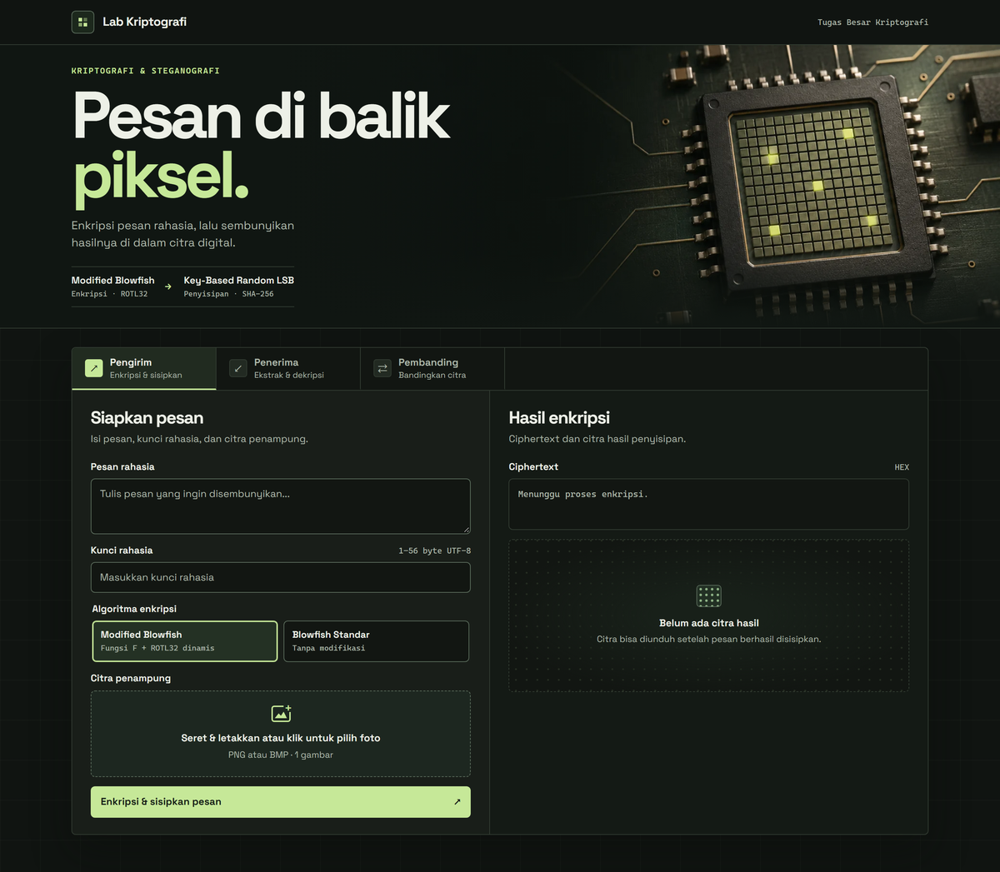
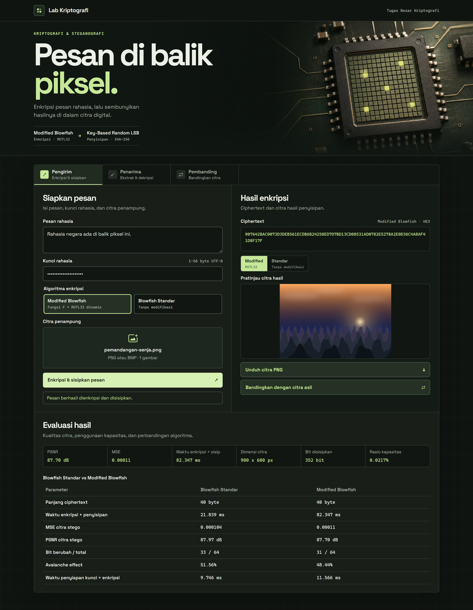
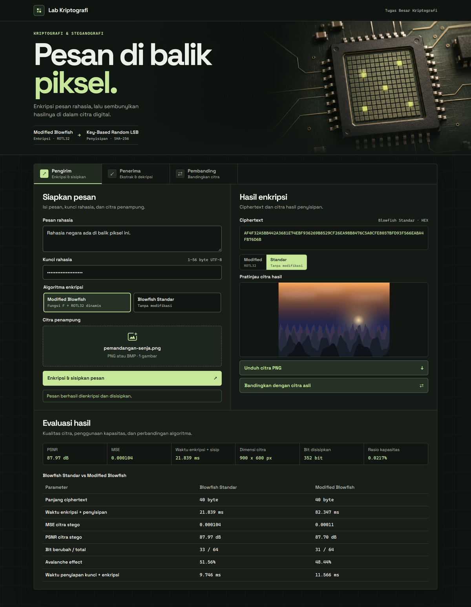
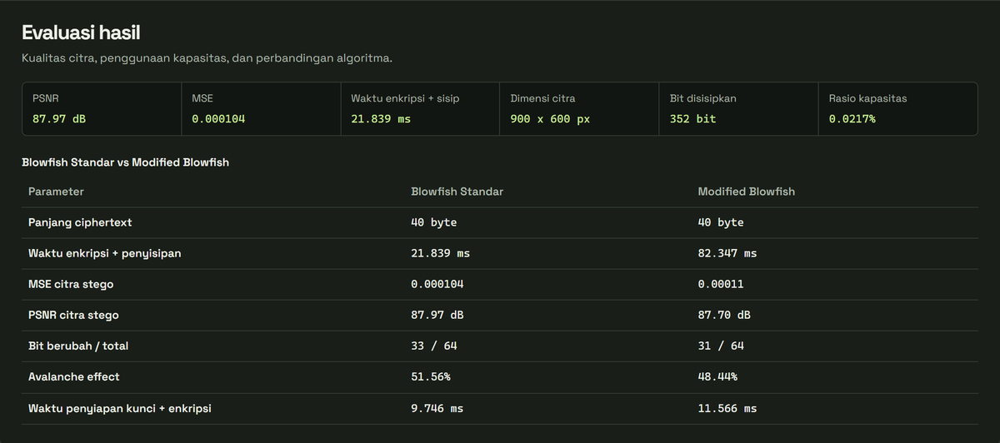
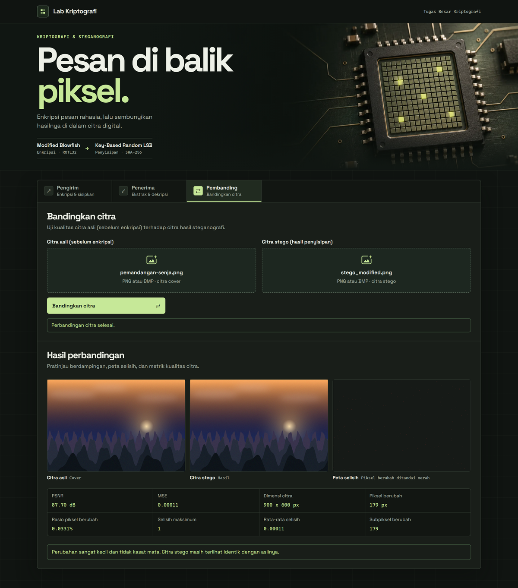
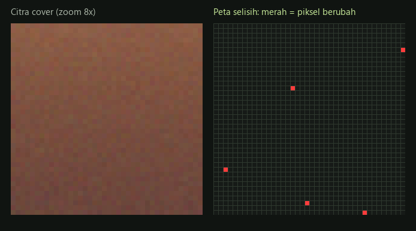
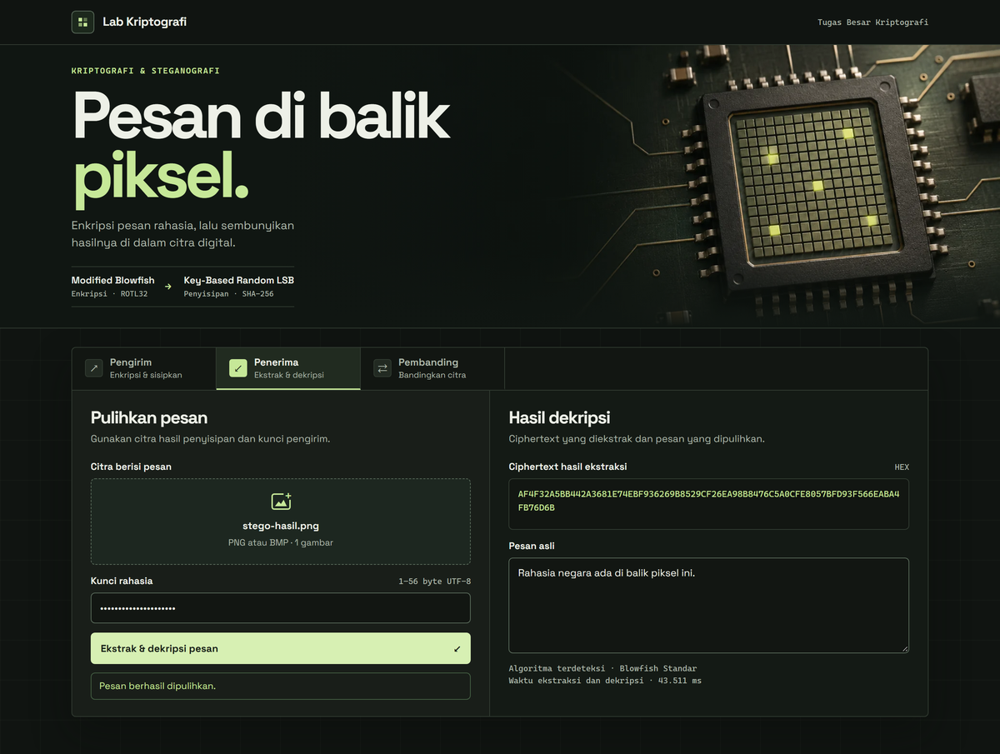

<div align="center">

# 🔐 Tugas Besar Kriptografi

**Pengamanan Pesan Teks menggunakan Modified Blowfish (Rotasi Bit Dinamis) & Steganografi Key-Based Random LSB pada Citra Digital**

[](https://www.python.org/) [](https://flask.palletsprojects.com/) [](https://numpy.org/) [](https://python-pillow.org/)

[](#metode) [](#metode) [](#cara-menjalankan-di-lokal) [](#lisensi)

</div>

---

Aplikasi web lokal untuk mengenkripsi pesan teks dengan Blowfish yang dimodifikasi, lalu menyembunyikan ciphertext ke dalam citra digital menggunakan steganografi LSB dengan urutan piksel acak yang diturunkan dari kunci rahasia.

> 💡 Aplikasi berjalan **sepenuhnya lokal** di komputer sendiri (`http://127.0.0.1:5000`) — tidak butuh internet, tidak butuh akun, dan pesan tidak pernah keluar dari mesin kamu.

---

## Daftar Isi

- [Fitur](#fitur)
- [Pratinjau Aplikasi](#pratinjau-aplikasi)
- [Kebutuhan Sistem](#kebutuhan-sistem)
- [Cara Menjalankan di Lokal](#cara-menjalankan-di-lokal)
- [Panduan Pemakaian (dengan Screenshot)](#panduan-pemakaian-dengan-screenshot)
  - [1. Tab Pengirim — Enkripsi & Sisip Pesan](#1-tab-pengirim--enkripsi--sisip-pesan)
  - [2. Varian Blowfish Standar](#2-varian-blowfish-standar)
  - [3. Tabel Evaluasi Algoritma](#3-tabel-evaluasi-algoritma)
  - [4. Tab Pembanding — Cover vs Stego](#4-tab-pembanding--cover-vs-stego)
  - [5. Tab Penerima — Ekstraksi & Dekripsi](#5-tab-penerima--ekstraksi--dekripsi)
- [Memahami Metrik](#memahami-metrik)
- [Struktur Proyek](#struktur-proyek)
- [Metode](#metode)
- [Pengujian Otomatis](#pengujian-otomatis)
- [Catatan Penggunaan](#catatan-penggunaan)
- [Troubleshooting](#troubleshooting)
- [Deploy Online (opsional)](#deploy-online-opsional)
- [Lisensi](#lisensi)

---

## Fitur

- **Enkripsi dua varian** — Modified Blowfish (ROTL32 dinamis pada fungsi F) dan Blowfish Standar, keduanya bisa langsung disisipkan ke citra.
- **Steganografi Key-Based Random LSB** — posisi bit disebar pseudo-acak menggunakan seed dari `SHA-256(secret_key)`, bukan LSB berurutan.
- **Dekripsi auto-deteksi** — penerima tidak perlu tahu algoritma yang dipakai; sistem mencoba kedua varian secara otomatis.
- **Pembanding citra** — membandingkan citra asli (cover) dengan citra stego: pratinjau berdampingan, peta selisih, MSE, PSNR, dan jumlah piksel yang berubah.
- **Evaluasi algoritma** — tabel perbandingan avalanche effect, waktu enkripsi, MSE, dan PSNR antara Blowfish Standar dan Modified Blowfish.
- **Antarmuka modern** — satu halaman dengan tiga tab, pratinjau citra langsung, dan unduhan stego sekali klik.

---

## Pratinjau Aplikasi

| Halaman awal | Form terisi |
|---|---|
|  |  |

| Hasil Modified Blowfish | Hasil Blowfish Standar |
|---|---|
|  |  |

---

## Kebutuhan Sistem

| Kebutuhan | Versi |
|---|---|
| Python | 3.9 atau lebih baru (diuji di 3.10 & 3.11) |
| pip | terbaru |
| RAM | minimal ~200 MB kosong |
| Browser | Chrome, Edge, Firefox, atau Safari versi terbaru |

Dependensi Python (sudah tercantum di `requirements.txt`):

| Paket | Fungsi |
|---|---|
| `flask` | Web server & routing API |
| `pillow` | Membaca/menulis citra PNG & BMP |
| `numpy` | Operasi array piksel untuk LSB dan metrik |

---

## Cara Menjalankan di Lokal

### 1. Buka terminal di folder proyek

```powershell
cd C:\project\TugasBesar_Kriptografi\TugasBesar_Kriptografi
```

### 2. (Disarankan) Buat virtual environment

Virtual environment membuat dependensi proyek tidak bercampur dengan Python global.

```powershell
python -m venv .venv
.\.venv\Scripts\Activate.ps1
```

> Jika PowerShell menolak dengan pesan *"running scripts is disabled"*, jalankan sekali:
> `Set-ExecutionPolicy -Scope CurrentUser RemoteSigned`
>
> Pengguna macOS/Linux: `python3 -m venv .venv` lalu `source .venv/bin/activate`

### 3. Install dependensi

```powershell
pip install -r requirements.txt
```

### 4. Jalankan aplikasi

```powershell
python app.py
```

Keluaran yang benar akan terlihat seperti ini:

```
Server berjalan di http://127.0.0.1:5000
 * Serving Flask app 'app'
 * Debug mode: on
 * Running on http://127.0.0.1:5000
```

### 5. Buka di browser

Buka **http://127.0.0.1:5000**

Halaman awal akan tampil seperti ini:


### 6. Menghentikan server

Kembali ke terminal, lalu tekan **`Ctrl` + `C`**.

> **Catatan:** `app.py` memakai `debug=True`, jadi setiap kali kamu menyimpan perubahan kode,
> server restart otomatis. Mode ini **hanya untuk pengembangan lokal** — jangan dipakai
> untuk server yang bisa diakses publik.

---

## Panduan Pemakaian (dengan Screenshot)

Skenario contoh di bawah memakai data berikut:

| Isian | Nilai |
|---|---|
| Pesan | `Rahasia negara ada di balik piksel ini.` |
| Kunci rahasia | `KunciRahasiaITERA2026` |
| Citra cover | foto pemandangan 900×600 px (PNG) |
| Algoritma | Modified Blowfish |

### 1. Tab Pengirim — Enkripsi & Sisip Pesan

Buka tab **Pengirim**. Isi keempat kolom:

1. **Pesan rahasia** — teks yang ingin disembunyikan.
2. **Kunci rahasia** — 1–56 byte (8–448 bit). Ingat baik-baik; kunci yang hilang berarti pesan tidak bisa dipulihkan.
3. **Algoritma** — pilih **Modified Blowfish** atau **Blowfish Standar**.
4. **Citra penampung (cover)** — seret file PNG/BMP ke kotak bergaris putus-putus, atau klik untuk memilih file.


Klik **Enkripsi & sisipkan pesan**. Setelah selesai, muncul dua panel:

- **Kiri** — pratinjau citra stego + tombol **Unduh citra stego**.
- **Kanan** — ciphertext heksadesimal, ringkasan metrik (PSNR, MSE, piksel berubah), dan tabel evaluasi.


> Perhatikan angka **PSNR 87,70 dB** dan **piksel berubah 179 dari 540.000 (0,0331 %)**.
> Artinya mata manusia tidak akan bisa membedakan citra stego dari citra aslinya.

### 2. Varian Blowfish Standar

Tombol sakelar **Modified Blowfish / Blowfish Standar** di panel hasil memungkinkan kamu
membandingkan kedua varian pada pesan dan cover yang sama, **tanpa perlu mengunggah ulang**.
Keduanya sama-sama menghasilkan citra stego yang bisa diunduh dan didekripsi.


### 3. Tabel Evaluasi Algoritma

Di bawah panel hasil terdapat tabel yang membandingkan kedua algoritma secara berdampingan:



Kolom yang dibandingkan: waktu enkripsi + penyisipan, MSE, PSNR, jumlah bit berubah,
**avalanche effect**, dan waktu penyiapan kunci.

Pada contoh di atas, Blowfish Standar menghasilkan avalanche effect **51,56 %** (33 dari 64 bit)
dan Modified Blowfish **48,44 %** (31 dari 64 bit). Keduanya mendekati nilai ideal **50 %**.

> **Catatan metodologi:** pengukuran dilakukan dengan membalik 1 bit pada blok plaintext
> pertama lalu membandingkan 64 bit ciphertext yang dihasilkan — yaitu **satu percobaan**.
> Selisih 2 bit di antara kedua varian karena itu masih berada dalam rentang variasi
> statistik, bukan bukti bahwa salah satu varian lebih lemah. Untuk kesimpulan yang lebih
> kuat, pengukuran perlu diulang pada banyak blok dan dirata-ratakan (lihat bagian
> [Pengujian Otomatis](#pengujian-otomatis)).

### 4. Tab Pembanding — Cover vs Stego

Tab **Pembanding** dipakai untuk membuktikan secara visual bahwa citra stego hampir identik
dengan aslinya. Unggah citra cover dan citra stego, atau klik tombol
**Bandingkan dengan citra asli** di panel hasil tab Pengirim untuk mengisinya otomatis,
lalu klik **Bandingkan citra**.



Hasilnya berisi:

- **Pratinjau berdampingan** — cover dan stego ditampilkan bersebelahan.
- **Peta selisih** — piksel yang berubah ditandai merah di atas latar gelap.
- **Metrik** — MSE, PSNR, jumlah piksel berubah, dan persentase perubahan.

Karena perubahan hanya ~0,03 % dari total piksel, peta selisih tampak hampir seragam.
Supaya terlihat, berikut perbesaran 8× pada area yang paling banyak berubah:



Kotak-kotak merah adalah piksel yang bit LSB-nya berubah karena dipakai menyimpan payload.

### 5. Tab Penerima — Ekstraksi & Dekripsi

Pindah ke tab **Penerima**. Unggah **citra stego** dan masukkan **kunci yang sama persis**
seperti saat enkripsi, lalu klik **Ekstrak & dekripsi pesan**.



Aplikasi akan:

1. Membaca 32 bit header untuk mengetahui panjang ciphertext.
2. Mengambil ciphertext dari posisi LSB acak yang sama (seed diturunkan dari kunci).
3. Mencoba dekripsi dengan **Modified Blowfish** dan **Blowfish Standar** secara otomatis.
4. Menampilkan pesan asli beserta label algoritma yang terdeteksi.

Jika kunci salah, aplikasi menolak dengan pesan
*"Pesan tidak ditemukan atau kunci rahasia salah."* — validasi PKCS#7 padding yang gagal
membuat hasil dekripsi tidak lolos pemeriksaan.

---

## Memahami Metrik

| Metrik | Arti | Nilai Bagus |
|---|---|---|
| **MSE** (Mean Squared Error) | Rata-rata kuadrat selisih nilai piksel antara cover dan stego. | Mendekati 0 |
| **PSNR** (Peak Signal-to-Noise Ratio) | Rasio kualitas sinyal terhadap noise, dalam dB. | **> 40 dB** = perbedaan tidak terlihat mata |
| **Piksel berubah** | Jumlah piksel yang sedikitnya satu kanal RGB-nya berubah. | Sangat kecil dibanding total piksel |
| **Avalanche effect** | Persentase bit ciphertext yang berubah ketika 1 bit plaintext/kunci diubah. | Ideal **50 %** |
| **Waktu proses** | Durasi enkripsi + penyisipan. | Semakin cepat semakin baik |

Hubungan MSE dan PSNR:

```
PSNR = 10 × log10(255² / MSE)   [dB]
```

Pada dokumentasi ini: MSE `0,00011` → PSNR `87,70 dB`, artinya kualitas citra stego
secara praktis tidak berkurang.

---

## Struktur Proyek

```
TugasBesar_Kriptografi/
├── app.py                  # Aplikasi web Flask: routing halaman & API
├── modified_blowfish.py    # Implementasi Blowfish Standar & Modified (ROTL32 dinamis)
├── random_lsb.py           # Steganografi Key-Based Random LSB (sisip & ekstrak)
├── metrics.py              # MSE, PSNR, avalanche effect, pembanding citra
├── test_evaluation.py      # Skrip pengujian otomatis (CLI)
├── requirements.txt        # Dependensi Python untuk lokal
├── templates/
│   └── index.html          # Struktur halaman: 3 tab (Pengirim/Penerima/Pembanding)
├── static/
│   ├── crypto.css          # Gaya antarmuka
│   ├── crypto.js           # Logika UI: unggah, panggil API, render hasil
│   ├── crypto-chip.webp    # Gambar hero
│   └── space-grotesk.woff2 # Font (SIL OFL)
├── docs/                   # Screenshot dokumentasi (dipakai README ini)
├── Dockerfile              # Opsional: image untuk deploy
├── requirements-space.txt  # Opsional: dependensi versi deploy
└── DEPLOY-HF.md            # Opsional: panduan deploy ke Hugging Face Spaces
```

Endpoint API yang dipakai antarmuka:

| Endpoint | Method | Fungsi |
|---|---|---|
| `/` | GET | Halaman utama |
| `/api/encode` | POST | Enkripsi pesan + sisip ke citra, kembalikan stego & metrik |
| `/api/decode` | POST | Ekstrak + dekripsi (auto-deteksi algoritma) |
| `/api/compare` | POST | Hitung MSE/PSNR + peta selisih cover vs stego |

---

## Metode

### 1. Modified Blowfish

Blowfish standar mengenkripsi blok 64-bit melalui 16 putaran Feistel dengan fungsi F:

```
F(x) = ((S1[a] + S2[b]) mod 2^32 XOR S3[c]) + S4[d] mod 2^32
```

Modifikasi yang diterapkan adalah **penambahan Circular Left Shift (ROTL32) dinamis** pada keluaran fungsi F:

```
F'(x, P[i]) = ROTL32(F(x), P[i] mod 32)
```

Jumlah rotasi ditentukan oleh 5 bit LSB sub-kunci `P[i]`, sehingga setiap putaran memiliki
pergeseran bit yang berbeda. Tujuannya adalah menambah sifat non-linear dan **memperkuat
avalanche effect**, yaitu perubahan satu bit pada plaintext atau kunci yang menyebar ke
banyak bit ciphertext.

> Klaim di atas adalah **rancangan** modifikasi. Pada pengujian yang disertakan di repo ini,
> avalanche effect kedua varian sama-sama mendekati 50 % dan selisihnya masih dalam variasi
> statistik — lihat catatan metodologi pada [Tabel Evaluasi Algoritma](#3-tabel-evaluasi-algoritma).

### 2. Key-Based Random LSB

Alih-alih menyisipkan bit secara berurutan dari piksel pertama (yang mudah dideteksi dengan
analisis statistik), posisi penyisipan dipilih acak:

1. `seed = SHA-256(secret_key)` sebagai bilangan 256-bit.
2. PRNG ber-seed tersebut menjalankan **Fisher-Yates parsial** untuk membangkitkan indeks sub-piksel RGB yang unik.
3. Setiap bit payload disisipkan ke bit LSB sub-piksel pada indeks tersebut.
4. Skema ini **prefix-invariant**: untuk mengekstrak 32 bit header maupun seluruh payload, urutan indeks yang dihasilkan selalu konsisten.

Payload yang disisipkan terdiri dari **header 32-bit** (panjang ciphertext) diikuti ciphertext hasil enkripsi.

### 3. Padding

Plaintext diberi **PKCS#7 padding** agar panjangnya kelipatan 8 byte (ukuran blok Blowfish).
Saat dekripsi, padding divalidasi sehingga kunci yang salah akan terdeteksi dan ditolak.

---

## Pengujian Otomatis

Selain lewat browser, seluruh mesin kripto & steganografi bisa diuji dari terminal:

```bash
python test_evaluation.py
```

Skrip ini menguji:

1. Fungsionalitas enkripsi–dekripsi dan penyisipan–ekstraksi pada berbagai panjang pesan.
2. Perbandingan avalanche effect dan kecepatan antara Blowfish Standar dan Modified Blowfish.
3. Kualitas citra steganografi (MSE & PSNR).
4. Negative test: memastikan kunci yang salah ditolak.

Contoh keluaran:

```
Panjang Teks   | Status   | AE Std   | AE Mod   | MSE        | PSNR (dB)  | Waktu (ms)
----------------------------------------------------------------------------------------
5              | VALID    |  39.06% |  51.56% | 0.000224   | 84.63      | 31.16
49             | VALID    |  42.19% |  45.31% | 0.001088   | 77.76      | 42.41
139            | VALID    |  46.88% |  62.50% | 0.002945   | 73.44      | 24.93
500            | VALID    |  50.00% |  50.00% | 0.010340   | 67.99      | 45.74
----------------------------------------------------------------------------------------
Uji Kunci Salah: BERHASIL DITOLAK -> (Pesan tidak ditemukan atau kunci rahasia salah.)
```

---

## Catatan Penggunaan

- **Format citra wajib PNG atau BMP.** Kompresi JPEG bersifat lossy dan merusak bit LSB, sehingga pesan tidak dapat dipulihkan.
- **Kapasitas citra** = `lebar × tinggi × 3` bit, dikurangi 32 bit untuk header. Citra 800×600 px menampung sekitar 179 KB data.
- **Kunci rahasia** 1–56 byte UTF-8 (8–448 bit), sesuai spesifikasi Blowfish.
- **Jangan kirim citra stego lewat aplikasi chat** yang mengompres gambar (WhatsApp, Telegram, dll.) — kompresinya merusak LSB. Kirim sebagai **file/dokumen**, bukan sebagai foto.
- **Kunci tidak disimpan di mana pun.** Kalau kunci hilang, pesan tidak bisa dipulihkan.

---

## Troubleshooting

| Masalah | Penyebab & solusi |
|---|---|
| `python: command not found` | Python belum terpasang atau belum masuk PATH. Install dari [python.org](https://www.python.org/downloads/) dan centang *"Add Python to PATH"*. |
| `ModuleNotFoundError: No module named 'flask'` | Dependensi belum terinstall, atau virtual environment belum aktif. Jalankan `pip install -r requirements.txt`. |
| `Address already in use` / port 5000 dipakai | Server lain masih jalan. Tutup dengan `Ctrl+C` di terminalnya, atau ubah `port=5000` di `app.py` menjadi `port=5001`. |
| Halaman terbuka tapi tombol tidak merespons | Hard refresh: `Ctrl` + `Shift` + `R`. Cache JS lama biasanya penyebabnya. |
| `Pesan tidak ditemukan atau kunci rahasia salah` | Kunci berbeda, atau citra stego sudah mengalami kompresi/konversi. Pastikan file asli (PNG/BMP) dan kunci sama persis. |
| Enkripsi terasa lambat | Blowfish key expansion memang berat CPU. Untuk citra besar (>2000 px) wajar butuh beberapa detik. |
| PowerShell menolak aktivasi venv | `Set-ExecutionPolicy -Scope CurrentUser RemoteSigned`, lalu aktivasi ulang. |

---

## Deploy Online (opsional)

Aplikasi ini dirancang untuk pemakaian lokal, tapi kalau perlu diakses lewat internet,
versi Flask-nya bisa dijalankan di **Hugging Face Spaces** dengan tampilan yang sama persis
(file `Dockerfile` dan `requirements-space.txt` sudah disiapkan).

Panduan langkah demi langkah: [`DEPLOY-HF.md`](DEPLOY-HF.md)

---

## Lisensi

Proyek akademik untuk Tugas Besar mata kuliah Kriptografi.
Font *Space Grotesk* digunakan di bawah SIL Open Font License (lihat `static/space-grotesk-OFL.txt`).
